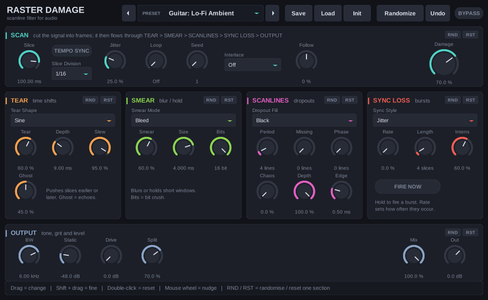

# Raster Damage

**A scanline filter for audio.** Raster Damage chops the signal into short slices and damages each one independently, like a corrupted video frame. Guitar, vocals, drums and full mixes all come out sounding like damaged media: torn tape, dropped scanlines, smeared pixels, a signal that loses sync.



## Download

Grab the build for your system from the **[Releases page](../../releases/latest)**:

| System | File | Editor |
|---|---|---|
| Windows 64-bit | `RasterDamage-windows-x64.zip` | full custom interface |
| Linux 64-bit | `RasterDamage-linux-x64.zip` | full custom interface |
| macOS (Intel + Apple Silicon) | `RasterDamage-macos-universal.zip` | generic host parameter UI (custom editor not ported yet) |

Releases are built automatically by GitHub Actions from this source, for every version tag.

A Windows build is also kept in the repo: [prebuilt/RasterDamage-win64.zip](prebuilt/RasterDamage-win64.zip).

### Install

- **Windows:** copy the whole `RasterDamage.vst3` **folder** to `C:\Program Files\Common Files\VST3\`, then rescan (Reaper: *Preferences > Plug-ins > VST > Clear cache/re-scan*). If it doesn't show up, run `check_plugin.bat` from the zip: it prints the exact load error.
- **Linux:** copy `RasterDamage.vst3` to `~/.vst3/` and rescan.
- **macOS:** copy `RasterDamage.vst3` to `~/Library/Audio/Plug-Ins/VST3/` and rescan. If macOS blocks it: `xattr -cr ~/Library/Audio/Plug-Ins/VST3/RasterDamage.vst3`. The macOS build is untested on real hardware.

## The idea

Parameters are organised around four visual-corruption metaphors:

| Metaphor | What it does to audio | Panel |
|---|---|---|
| **Horizontal tearing** | each slice is shifted by a short delay offset (with optional slew and ghost feedback) | TEAR |
| **Missing scanlines** | periodic dropouts inside every slice, filled with silence, hold, noise or the previous line | SCANLINES |
| **Pixel smearing** | short-window averaging, sample-and-hold, bleed and bit crushing | SMEAR |
| **Sync loss** | controlled bursts of timing disruption: jitter, roll, stutter | SYNC LOSS |

Every damage decision is derived from `hash(seed, slice number, purpose)`, so the effect is **deterministic**: the same audio at the same position always damages the same way, regardless of host buffer size. That makes it repeatable, loopable (the *Loop* control repeats a run of damaged frames) and lockable to tempo (*Sync* + *Slice Division*).

Signal flow per channel:

```
in -> delay line -> TEAR -> SMEAR -> SCANLINES -> sync-loss snow -> BANDWIDTH -> DRIVE -> MIX -> out
```

The plugin reports 2 samples of latency so the dry path in *Mix* stays phase-aligned.

## The interface


The layout follows the signal flow: **SCAN > TEAR > SMEAR > SCANLINES > SYNC LOSS > OUTPUT**.

- **Top bar:** preset dropdown (by category, then *My presets*), ◀ ▶, **Save**, **Load**, **Init**, **Randomize**, **Undo**, **Bypass**.
- **Each section:** a mode dropdown, its knobs, and **RND** (randomise just this section, within musical ranges) / **RST** (reset just this section) in the header.
- **SCAN:** slice length (ms or tempo-synced), jitter, loop, seed, interlace, input follow, and the big **DAMAGE** knob.
- **FIRE NOW** (in SYNC LOSS): hold to trigger a sync-loss burst.
- **Hint bar:** hover anything for its name, exact value and a one-line explanation.

Mouse: drag, **Shift** = fine, **double-click** = reset, wheel = nudge.

## Presets

77 factory presets, all 100% wet (only the processed sound, no original bleeding through):

| Category | Count |
|---|---|
| Basics | 1 |
| Broken video | 8 |
| Corrupted media | 7 |
| Guitar | 6 |
| Vocals | 5 |
| Drums | 6 |
| Sync loss / extremes | 5 |
| Textures | 9 |
| Scenes (VHS tape, security camera, datamosh, failing satellite...) | 10 |
| Rhythm (tempo-synced grids, gates, shredders) | 7 |
| Instruments (guitar, vocal, drums, bass, synth, mix bus) | 13 |

Choosing a preset sets **every** control and informs the host, so automation and the UI always agree. Touching any control marks the preset *modified*. Reloading a project restores your exact settings, not the preset's.

### Your own presets

**Save** writes a `.rdpreset` text file, **Load** reads one. The dropdown also lists everything in your preset folder under *My presets*.

| OS | Folder |
|---|---|
| Windows | `Documents\Raster Damage\Presets` |
| Linux | `~/.local/share/Raster Damage/Presets` |
| macOS | `~/Library/Application Support/Raster Damage/Presets` |

The format is plain text (`format=1`, `name=...`, then `Parameter Name=value`). Unknown keys are ignored, missing ones use defaults, and values are clamped, so presets can be edited by hand and shared safely.

## Documentation

[GUIDE.md](GUIDE.md) is the full manual: every parameter with range and default, every preset, practical recipes (guitar, vocals, drums), and troubleshooting.

## Troubleshooting

- **Not in Reaper / another host:** the folder must be copied whole (a loose `.dll` is not scanned). Clear the host's plugin cache and rescan. Make sure the host is **64-bit**; the plugin is x86_64 only. Run `check_plugin.bat`.
- **Windows blocked the file:** right-click the downloaded .zip > Properties > Unblock, then extract.
- **No effect heard:** check that **Damage** > 0, **Mix** > 0 and **Bypass** is off.
- **Still hearing the original:** Damage below 100% leaves some slices untouched by design; raise it. Mix below 100% blends dry signal in.

## Build from source

Needs CMake and a C++17 compiler. The VST3 SDK (MIT licence) is fetched by the scripts.

**Windows:** install CMake, Git and either Visual Studio Build Tools (Desktop C++) or MinGW-w64, then run:

```
build.bat            # fetch SDK, build, run self-test, assemble dist\RasterDamage.vst3
build.bat install    # same + copy to the system VST3 folder (Administrator prompt)
```

**Linux (native):**

```
scripts/get_sdk.sh
cmake -S . -B build -G Ninja && cmake --build build      # -> build/dist/RasterDamage.so
```

**Cross-compile the Windows DLL from Linux (MinGW-w64):**

```
scripts/get_sdk.sh
cmake -S . -B build_win -G Ninja -DCMAKE_TOOLCHAIN_FILE=scripts/mingw-toolchain.cmake
cmake --build build_win                                   # -> build_win/dist/RasterDamage.vst3
```

### Tests and tools

```
build/rd_test             # 6,656 DSP checks (parameter maths, bit-exact clean path, tear delays,
                          # dropouts, smear, sync loss, loop, tempo lock, block-size independence
                          # for every preset, NaN/overflow fuzzing)
build/rd_test_controller  # 31 checks: preset selection updates every parameter, user presets, state restore
build/rd_render --demo demo.wav --preset "Tracking Error VHS"    # hear a preset without a DAW
```

The native Linux build passes Steinberg's official `validator` (47/47). The Windows DLL has been load-tested and its editor opened under Wine.

### Layout

```
src/RasterParams.h       parameter table (ids, ranges, curves, text): single source of truth
src/RasterEngine.h       DSP engine, header-only, no SDK dependency
src/RasterPresets.h      factory presets
src/RasterPresetIO.h     .rdpreset save/load
src/Raster{Processor,Controller,Entry}.cpp   VST3 wrapper
src/gui/                 VSTGUI editor (+ MinGW shims)
tests/                   DSP and controller tests
tools/                   offline renderer, GUI screenshot, Windows load/scan test hosts
prebuilt/                Windows 64-bit build
```

## Status and limits

- VST3 only (no VST2). Stereo and mono, 32/64-bit processing.
- The Windows build was cross-compiled with MinGW-w64 and tested under Wine, not yet across many real DAWs. Please open an issue with your host and the output of `check_plugin.bat` if something fails.
- macOS builds the DSP/plugin but without the custom editor; the Visual Studio (MSVC) build path is untested.
- Parameter ids and the saved-state format are versioned. Do not renumber `ParamId` once you have saved projects.

## Licence

Plugin code: MIT (see [LICENSE](LICENSE)). Uses the Steinberg VST3 SDK (MIT) and VSTGUI (BSD). "VST" is a trademark of Steinberg Media Technologies GmbH.
